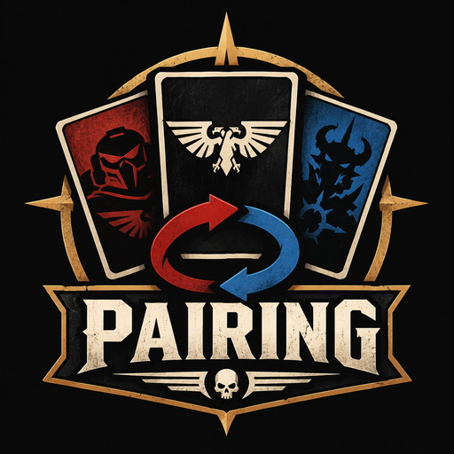

<p align="center"></p>

# Pairing 40k

Application Android (APK) pour gérer le **mini-jeu des pairings** de Warhammer 40 000 en
tournoi par équipes (format WTC / ETC), en **8v8, 6v6** (et 4v4) : à partir de la matrice
des scores estimés de l'équipe, elle calcule la meilleure façon de poser ses cartes
(défenseur, attaquants, choix du défenseur) pour maximiser les points de l'équipe —
y compris les matchs des **attaquants refusés** et des **oubliés** de la dernière manche.

## Télécharger l'APK

Chaque push déclenche le workflow **Build APK** (onglet *Actions*) : tests unitaires,
puis APK release signé, publié en artefact **Pairing40k**. Toutes les versions sont signées
avec la même clé (committée dans `keystore/`), donc un nouvel APK s'installe par-dessus
l'ancien sans désinstaller.

## Le pairing modélisé

Avec *k* joueurs restants de chaque côté, une manche se joue ainsi :

1. chaque équipe pose un **défenseur** face cachée, révélation simultanée ;
2. chaque équipe pose **deux attaquants** face au défenseur adverse ;
3. chaque défenseur **choisit** son adversaire parmi les deux attaquants ;
   l'attaquant refusé retourne dans le pool.

Deux matchs sont fixés par manche. Quand il reste 4 joueurs, les deux **attaquants refusés**
s'affrontent et les deux joueurs jamais posés (**les oubliés**) aussi.
8v8 = 2 + 2 + 4 matchs, 6v6 = 2 + 4.

Comme les cartes sont révélées simultanément, chaque étape est un jeu à somme nulle :
l'app le résout exactement (programmation linéaire, stratégies **mixtes**) sur
**toutes** les séquences possibles, avec mémoïsation — un 8v8 complet prend moins
d'une seconde. Deux lectures sont données à chaque fois :

- **Espérance** : points attendus face à un adversaire qui joue parfaitement ;
- **Plancher** : ce qu'on s'assure en choix purs même si l'adversaire lit notre jeu.

> La stratégie optimale est souvent un *mélange* (ex. « défenseur A 60 %, B 40 % ») :
> le bouton 🎲 tire la carte selon ces probabilités, pour rester imprévisible.

## Fonctionnalités

**Matrice**
- Import **CSV / TSV** (séparateur `;` d'Excel FR, `,`, tabulation), **Excel .xlsx**,
  **lien Google Sheets** (partagé « tous les utilisateurs disposant du lien », l'onglet
  du lien est importé), **copier-coller** d'une plage Sheets/Excel, ou fichier
  partagé/ouvert depuis Drive, mail…
- Deux dispositions : **grille** (adversaires en 1re ligne, nos joueurs en 1re colonne,
  lignes/colonnes de factions facultatives) ou **liste** `joueur ; adversaire ; score`.
- Échelles reconnues automatiquement (modifiable à l'aperçu) : points 0-20, notes 1-5,
  relatif −2…+2, symboles `-- - = + ++`, pourcentages, scores `13-7`.
- Noms au format `Jean (Orks)` → nom + faction.
- Édition directe, carte de chaleur, plusieurs confrontations (préparer tout le tournoi),
  dupliquer, **inverser** le point de vue, notes, export CSV / partage.
- **Sauvegarde JSON** à partager entre coéquipiers (fusion à la restauration).

**Analyse**
- Score attendu, plancher garanti, bornes idéale / pire (affectation optimale).
- Premier défenseur recommandé (probabilités), défenseur adverse probable.
- **Affiches probables** : probabilité que chacun de nos joueurs affronte chaque adversaire.
- Contribution attendue par joueur, profils (moyenne / min / max par ligne et colonne).

**Pairing en direct**
- Pas à pas : défenseurs → attaquants → choix, recommandations à chaque étape
  selon ce qui a été révélé, projection du score final en continu.
- Aperçu des 4 derniers matchs (refusés + oubliés) avant de valider la dernière manche.
- Annuler / recommencer, partage du récapitulatif.
- **Mode entraînement** : un adversaire virtuel joue sa stratégie optimale.

**Historique**
- Pairings enregistrés, saisie des **scores réels** après les parties.
- **Fiabilité des estimations** : écart moyen, biais (matrice optimiste / pessimiste),
  biais par joueur.

## Format de fichier

Exemples dans [`exemples/`](exemples) :

```
Nous \ Eux;Ivan (World Eaters);Julie (Chevaliers Gris);…
Antoine (Space Marines);2;12;…
Bastien (Orks);13;7;…
```

```
Joueur,Adversaire,Estimation
Antoine,Ivan,--
Antoine,Julie,+
```

Les couleurs de cellules ne sont pas exportées en CSV : utiliser des valeurs (ou symboles).

## Idées pour la suite

- **Matrice adverse** : saisir aussi ce que *l'adversaire* pense des affiches (ses
  estimations diffèrent des nôtres) et exploiter l'écart.
- **Choix des tables / missions** : matrice par type de table, le défenseur choisit sa table.
- **Incertitude** : une fourchette par affiche (ex. 8-14) et la probabilité de gagner le
  round d'équipe (> moitié des points), pas seulement l'espérance.
- **Profil de risque** : privilégier le plancher quand une égalité suffit, l'espérance sinon.
- **Adversaire « humain »** : modéliser des habitudes (défenseur favori) apprises de l'historique.
- **Saisie collaborative** : chaque joueur remplit sa ligne, fusion automatique ; QR code
  pour transmettre la matrice d'un téléphone à l'autre.
- **Base de factions / listes** et estimation pré-remplie à partir de l'historique des résultats.
- **Mode chrono** pour la phase de pairing en tournoi, et export PDF du récapitulatif pour l'arbitre.

## Développement

```
./gradlew testDebugUnitTest   # moteur de pairing, import, sauvegarde
./gradlew assembleRelease     # app/build/outputs/apk/release/app-release.apk
```

- `engine/` : `MatrixGame` (jeux à somme nulle), `PairingSolver` (valeurs, analyses
  d'étapes, probabilités des affiches), `PairingSession` (déroulé), `Assignment`.
- `data/` : modèle, `MatrixImport` (CSV, détection, échelles, Google Sheets), `Xlsx`, `Store`.
- `ui/` : écrans Compose (Matrice, Analyse, Pairing, Historique).
